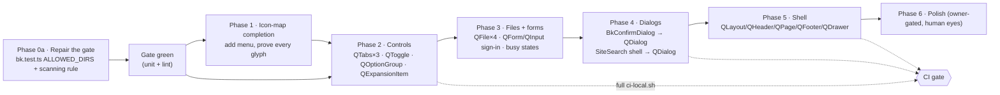

# Analysis Report: Quasar Migration Audit for Barykady Kultury (T-049, v2 plan review)

**Ticket:** T-049 — Quasar-first UI consolidation (SCSS-only styling)
**Scope audited:** all 81 `.vue` components under `apps/web/barykadyKultury/src`, the `src/components/bk/` seam, the mechanical inventory, `docs/DESIGN_SYSTEM.md`, `docs/architecture.md`, `docs/tickets/DECISIONS.md`, the Quasar 2.35.1 library source, and the official Quasar v2 documentation.
**Date:** 2026-10-26 · **Analyst:** @analyzer (qwen3.8-flash) · **Read-only audit:** no application code or ticket documents were modified.

---

## Methodology

Six methods were applied deliberately, and each produced a distinct class of finding:

1. **Ground-truth-before-claim (systems thinking).** Every number in the plan was re-measured from the tree instead of accepted: `scripts/ui-inventory.mjs` was re-run in `--stdout` mode (no file writes) and an independent scanner was written to count utility tokens *only inside `class`/`:class` values, with HTML comments stripped*. This is what produced Corrections C1–C3.
2. **Library source over prose (first-principles).** Quasar 2.35.1 is installed locally, so every ARIA/DOM claim was verified in `node_modules/quasar/src/components/**` (`QTh.js`, `QTable.js`, `get-table-middle.js`, `QPage.js`, `QDialog.js`, `QInput.js`, `QSelect.js`, `QBtnToggle.js`, `QOptionGroup.js`, `QExpansionItem.js`, `QBreadcrumbs.js`) and cross-checked against the live v2 docs. Docs describe intent; source proves output.
3. **Decision-ledger traceability.** Each recommendation was checked against the committed decision register (`DECISIONS.md` D-20, D-25…D-27, D-32–D-34, D-38, D-40). One recommendation in the plan (QBtnToggle) directly contradicts a binding decision (D-34).
4. **5-Whys on the flagged components.** For `UiConfirmDialog`/`BkConfirmDialog` and `LanguageSwitcher`, the question "why does this exist hand-rolled?" was asked down to the recorded rationale (happy-dom + teleport timing; user-reported hover-menu bugs), then tested against the framework reality.
5. **Inversion ("how would we guarantee an accessibility regression?").** Enumerating the a11y contracts a migration would silently break — `<caption>`, `th scope`, `aria-current`, `ol` sequence, `lang` per option, skip-link focus handoff, `getByRole("navigation").first()` — produced the risk register and the D1/D5 recommendations.
6. **Boundary cases.** 320 px, 200 % zoom, no-JS `<details>`, reduced motion, dark theme (D-20 dual selector), and happy-dom's lack of real transitions.

Citations are MLA-form; see **Works Cited**.

---

## 1. Terminal visualizations

### 1.1 Measured reality vs. the plan's stated reality

```
╔══════════════════════════════════╤═══════════════════════╤════════════════════════╤═════════════════════════╗
║ Fact                            │ T-049 plan v2         │ Committed inventory    │ Measured today (tree)   ║
╠══════════════════════════════════╪═══════════════════════╪════════════════════════╪═════════════════════════╣
║ Utility-class tokens            │ 61, all ImportPage    │ 89 in 7 files          │ 0 (class-value scan)    ║
║ …files affected                 │ 1                     │ 7                      │ 0                       ║
║ Native control instances        │ 35 (20 files)         │ 39 (20 files)          │ 36 (3 are comment hits) ║
║ Seam location                   │ src/components/ui/    │ src/components/ui/     │ src/components/bk/ ✅   ║
║ Wrapper naming                  │ Ui*                   │ Ui*                    │ Bk* (full words) ✅     ║
║ Seam gate status                │ green                 │ green                  │ RED 22:03 → green 22:29 ║
║ Icon strategy                   │ "must be decided"     │ —                      │ SHIPPED since T-032 ✅  ║
║ PageToc/ReaderToc duplication   │ "eliminate the split" │ —                      │ already unified ✅      ║
╚══════════════════════════════════╧═══════════════════════╧════════════════════════╧═════════════════════════╝
```

### 1.2 Adoption-decision matrix (impact × migration risk)

```
                 High a11y/product impact
                          │
   ADOPT (real gain)      │  PROVE FIRST (gate/test)
   ─ QTabs ×3 (kills 3    │  ─ QLayout/QPage/QDrawer shell
     hand-rolled tablists)│    (skip-link + #main + dvh)
   ─ QToggle (switch)     │  ─ QDialog for SiteSearch shell
   ─ QFile ×4             │  ─ QDialog inside BkConfirmDialog
   ─ QOptionGroup (D-34)  │
   ─ QForm+QInput sign-in │
                          │
 ─────────────────────────┼─────────────────────────→ Risk to existing contracts
                          │
   SKIP (framework can't   │  DEFER (no product need)
   match the contract)     │  ─ QImg/QAvatar over native img
   ─ QTable over admin     │  ─ QBreadcrumbs (no role/aria at all)
     tables (no caption,   │  ─ QScrollArea/QPageSticky/QPageScroller
     no th scope)          │  ─ QMenu over LanguageSwitcher
   ─ QSelect over Site-    │  ─ QExpansionItem for the reader
     Search combobox       │    (mobile TOC only — D4)
   ─ QImg/QUploader/etc.   │
      Low impact           │
                 Low a11y/product impact
```

### 1.3 Root cause of the plan's stale numbers (cause → effect)

```
   scripts/ui-inventory.mjs
            │
            ├─ templateOf() strips <script>/<style> …
            │        but NOT <!-- HTML comments ──────────► <details> counted 3×
            │                                               (PageToc:9, LFR:7, ReaderToc:4)
            ├─ UTILITY_CLASS runs on the whole template ──► scope="col" / colspan /
            │        (not just class attribute values)      "position:absolute" prose
            │                                               counted 23× in 6 files
            └─ snapshot committed before the bk/ rename ──► paths, line counts and
                                                            token totals all stale
                                                            │
                                                            ▼
                                       plan v2 sized "Phase 0" from a number
                                       that no longer describes the tree at all
```

### 1.4 Recommended phase order (Mermaid)



The shell moves **last**, not second: it is the only phase that can invalidate landmark, skip-link, focus-walk and `getByRole("navigation").first()` assertions in five E2E specs at once, and nothing in Phases 1–4 depends on it.

---

## 2. Findings — Task A: complete per-component audit (81/81)

Verdicts are keyed to the measured shape of each file. "Native controls" counts exclude the three comment false positives (§C2). Phases refer to §4.

### 2.1 Shell and layout (5)

| # | Component | Current shape (evidence) | Verdict | Wrapper | Phase | Risk / test impact |
|---|---|---|---|---|---|---|
| 1 | `src/App.vue` | 4 lines, `<router-view>` only | **keep** | — | — | none |
| 2 | `layouts/PublicLayout.vue` (165 L) | hand-rolled flex shell: skip link with `@click.prevent` focus handoff → `<main id="main" tabindex="-1">` (`:27-38`, `:86-92`); `min-height:100dvh` (`:101`) | **adopt QLayout + QHeader/QPageContainer/QPage/QFooter** — QPage *is* `<main>` ("Layout," sec. Accessibility) | `BkLayout`, `BkHeader`, `BkPageContainer`, `BkPage`, `BkFooter` | **5** | Highest-risk file in the migration. Keep `id="main"` + `tabindex="-1"` on QPage (attrs inherit to its `<main>`, `QPage.js:64-73`). QPage injects `min-height` in **vh** (`QPage.js:40-59`) — the repo deliberately uses `dvh`; override with `:style-fn`. Skip link must stay the first focusable node inside QHeader. `keyboard-focus.spec.ts:48-57` (skip → `main` focused) and `shell.spec.ts` (`banner`/`contentinfo`/`navigation.first()`) must stay green; margins on layout children break QLayout outright ("Layout," sec. Usage warning). |
| 3 | `layouts/AdminLayout.vue` (477 L) | same shell pattern, `<main id="admin-main">` (`:205`), 11 scope-gated `RouterLink` nav items with `aria-current="page"` (`:54-176`), one hand-rolled sign-out button with `aria-busy`/`disabled` (`:192-201`) | **adopt QLayout shell** (same wrappers) + `BkButton` for sign-out; **keep `nav > ul`** for the desktop admin bar (nav ≠ tabs) | `BkLayout`, `BkHeader`, `BkPage`, `BkButton` | **5** | `AdminLayout.test.ts:97` asserts `main[id="admin-main"]`; `admin-auth.spec.ts:129` asserts it is focused. Nav items are capability-gated (`can('team:write')`) — a QList rewrite adds no semantics and loses the `nav` landmark name asserted in `keyboard-focus.spec.ts`. |
| 4 | `components/AppShell.vue` (65 L) | minimal 404 shell: skip link `href="#main-content"` **without** the focus handoff handler (`:3`), `<main id="main-content">` (`:11`) | **keep native** for now; if Phase 5 ships, mirror PublicLayout so there is one shell model — and fix the missing `@click.prevent` skip behaviour as its own small a11y item | `BkLayout` (optional) | **5** | `404.vue` renders it; no E2E targets `#main-content`. Note the asymmetry: PublicLayout's skip link works, AppShell's relies on router hash handling. Flag as an independent defect, not a Quasar question. |
| 5 | `components/navigation/AppHeader.vue` (533 L) | `<header role="banner">`, 3-column grid, desktop `nav > ul > RouterLink` with `aria-current="page"` + brand-stroke underline (`:47-62`, `:373-377`), mobile `#app-panel` CSS-swapped drawer (`:35-40`, `:470-488`), hamburger `<button aria-expanded aria-controls>` with `☰`/`✕` text glyphs (`:96-111`), phone-band `<600 px` search relocation (`:83`, `:93`) | **adopt QDrawer** for the mobile panel (backdrop, Escape, body-scroll lock, `<aside>` landmark); **keep** `nav > ul` desktop; `BkButton` + `aria-expanded`/`aria-controls` for the hamburger | `BkDrawer`, `BkButton` | **5** | `breakpoint` must be **1279**, not the plan's 1024 (the drawer band is `max-width: 1279px`, `:458`; Quasar's default is 1023 — "Drawer," sec. Desktop and mobile behavior). QDrawer puts fall-through attrs on the *inner scrolling element*, and only `role`/`aria-*` on the `<aside>` ("Drawer," sec. Accessibility) — so the `#app-panel` id contract (`AppHeaderPhone.test.ts:69` queries `#app-panel .app-header__controls`) survives only if the controls stay inside that element. **QDrawer does not trap focus** — quoted: "it does not trap or move keyboard focus, so the page behind the backdrop remains keyboard-reachable" ("Drawer," sec. Your responsibilities); keep the tested composable. `☰`/`✕` are text, not icons → they may become `icon="menu"`/`icon="close"`, and `menu` is **not** in the icon map (§C3). |

### 2.2 Navigation and chrome (4)

| # | Component | Current shape | Verdict | Wrapper | Phase | Risk / test impact |
|---|---|---|---|---|---|---|
| 6 | `navigation/AppFooter.vue` (254 L) | `<footer>` + `nav` + `address` + `SocialLinks`, `aria-current` | **adopt QFooter as the wrapper only**, keep content | `BkFooter` | 5 | `shell.spec.ts` asserts `contentinfo` ×4 |
| 7 | `navigation/MobileBottomNav.vue` (244 L) | `nav > ul > RouterLink` with hand-authored inline `<svg>` icon shapes (`:40-56`) + a "More" `<button aria-expanded aria-controls="app-panel">` | **keep component**, swap only the More button to `BkButton`; do **not** force QTabs (nav ≠ tabs) | `BkButton` | 2 | `MobileBottomNav.test.ts:91` asserts `aria-controls`; `mobile-bottom-nav.spec.ts` |
| 8 | `navigation/SocialLinks.vue` (262 L) | `ul > li > a` with inline SVG, accessible names, visibility flags | **keep native** | — | — | `AppHeaderSocial.test.ts`, `brand-stroke.spec.ts` |
| 9 | `navigation/PageToc.vue` (478 L) | one `nav` landmark, two CSS-swapped renderings of the same list; desktop sticky list, **mobile native `<details>`** (`:47-52`); `IntersectionObserver` scroll spy + bottom-of-page shortcut (`:126-196`); `BkList tag="ul"` + `BkItem tag="a"` rows with `aria-current="location"` (`:292-329`) | **keep the `<details>`/`<summary>` disclosure** (D4); keep the list tree; optional `QIntersection` later | `BkList`, `BkItem`, `BkExpansionItem` (unused) | 4 (optional) | `about-rail.spec.ts` asserts `aria-current` ×9 and `navigation "On this page"`; `PageToc.test.ts` asserts the details contract. `<details>` works with **zero JS** — QExpansionItem would regress no-JS and add `keyboard_arrow_down` chrome the rail doesn't want. |

### 2.3 Controls and forms (10)

| # | Component | Current shape | Verdict | Wrapper | Phase | Risk / test impact |
|---|---|---|---|---|---|---|
| 10 | `ThemeToggle.vue` (136 L) | `<label>` wrapping `input[type=checkbox] role="switch" aria-checked` (`:2-12`); name = visible text (WCAG 2.5.3); handle position = non-colour state | **adopt QToggle** (`role="switch"` + `aria-checked` built in) | `BkToggle` (new) | 2 | `shell.spec.ts` `getByRole("switch", {name:"Dark mode"})`, `about-rail.spec.ts`, `theme.spec.ts`, `ThemeToggle.test.ts`. Must keep *label-in-name*: QToggle's accessible name comes from its `label`/slot, so pass the visible localized text as the label, not `aria-label`. |
| 11 | `LanguageSwitcher.vue` (447 L) | **disclosure**, explicitly documented as "not a menu/listbox" (`:122-125`), with three OR-ed open signals (`hoverOpen`/`focusOpen`/`pinnedOpen`, `:140-177`), a 120 ms pointer-leave grace (`:158-169`), an invisible `::before` hover bridge across the trigger seam (`:414-421`), pointer-type discrimination so a mouse click must not pin (`:238-263`), `aria-current` on the active locale (`:63`) | **keep native** (status quo); do not adopt QMenu/QBtnDropdown | `BkButton` (optional, for the trigger only) | — | The plan's QBtnDropdown verdict would delete ~200 lines that exist **because of user-reported bugs** (the dead 4 px gap; mouse-click pinning). QMenu's `hover` mode has no equivalent of "keyboard focus opens but a pointer click must not pin", and it swaps `aria-current` → `aria-checked` (`keyboard-journeys.spec.ts` asserts `aria-expanded` ×9 + the `/Language/` button name). If the owner still wants QMenu, it must be an explicit reversal of the component's documented design note, not a side effect of Phase 3. |
| 12 | `admin/AdminTabs.vue` (124 L) | hand-rolled `role="tablist"` + `role="tab"` + roving `tabindex` + Arrow/Home/End (`:9-31`) | **adopt QTabs/QTab (+ QTabPanels)** | `BkTabs`, `BkTab` (new) | 2 | Deletes the keyboard code; must preserve `aria-controls="{prefix}-panel-{id}"` targets — QTabPanels supplies panel ids, so the current `idPrefix` contract (`AdminSettingsPage.vue:17-23`) must be re-expressed |
| 13 | `admin/AdminLocaleTabs.vue` (142 L) | same pattern, each tab renders `TranslationStatus` (`:22-38`) | **adopt QTabs/QTab** | `BkTabs`, `BkTab` | 2 | tab content is compound (label + status) → must use the default slot, not `label` prop |
| 14 | `pages/admin/AdminProjectEditPage.vue` (895 L) | third hand-rolled tablist at `:139` + `onTabKeydown`; native file input at `:104` | **QTabs + QFile** | `BkTabs`, `BkFile` | 2 / 3 | `admin-projects.spec.ts` (asserts a `dialog`), `AdminProjectEditPage.cover.test.ts` |
| 15 | `content/ContentUpdateBanner.vue` (70 L) | `div role="status" aria-live="polite"` + action `<button>` (`:2-11`) | **keep QBanner wrapper** (already used by parents), action → `BkButton` | `BkBanner`, `BkButton` | 2 | `publication-detail.vue:24`, `about-document.vue` assertions |
| 16 | `admin/OrganizationSettingsForm.vue` (613 L) | seam-based form (`BkInput`×3, `BkCheckbox`×3, `BkBanner`×2, `BkButton`×2) + `AdminTabs`; 1 `tabindex` | **keep**, already conformant | — | — | `AdminSettingsPage.test.ts` |
| 17 | `admin/AdminSubmitShell.vue` (154 L) | `<component :is="form|div">` with `aria-busy` + `role="status"`/`aria-live` feedback regions, mode-conditional slots | **keep** (presentation shell, no control to swap); optionally host `BkForm` | `BkForm` (optional) | 3 | `AdminSubmitShell.test.ts` asserts `data-testid="admin-submit-shell"`, `aria-busy` |
| 18 | `admin/TranslationStatus.vue` (41 L) | single `<span>` text verdict | **keep native** | — | — | shared by tabs/pages; no Quasar value |
| 19 | `pages/admin/AdminSignInPage.vue` (364 L) | hand-rolled `form novalidate` with two labelled inputs (`autocomplete`, `aria-invalid`, `aria-describedby` + error `<p id>`) + submit `<button aria-busy>` (`:30-95`), single persistent live region | **adopt QForm + QInput + BkButton[type=submit]** — the *only* place QInput's `error`/`error-message` + `for`/`id` wiring clearly beats the hand-rolled version | `BkForm`, `BkInput`, `BkButton` | 3 | Auth boundary: migrate only with `AdminSignInPage.test.ts` + `admin-auth.spec.ts` + `keyboard-focus.spec.ts:152` (Tab-and-type credential fill) green. `autocomplete="email"/"current-password"` and `spellcheck` must be passed through; QInput forwards unknown attrs to the inner `<input>` (`QInput.js:170-181`) |
| 20 | `search/SiteSearch.vue` (823 L) | see §2.6 / D2 | **shell → QDialog; keep the listbox internals** | `BkDialog`, `BkButton`, `BkTooltip` | 4 | `search.spec.ts` (`dialog` ×9, `combobox` ×5, `option`, `aria-pressed` ×5) |

### 2.4 Content surfaces — public (12)

All twelve are presentation-semantic and, in my judgement, **keep native**. Reason stated once, with per-item notes: they already produce exactly the landmarks and text structure WCAG 2.2 AA and `DESIGN_SYSTEM.md` §6 require (`li` items, `time datetime`, `img alt/width/height/loading=lazy`, `role="note"`, sr-only range words), and Quasar has no component whose DOM is a better fit.

| # | Component | Shape | Verdict | Why not Quasar |
|---|---|---|---|---|
| 21 | `events/EventCard.vue` (245 L) | `li` + dynamic heading `h{level}` + `time` pair + registration anchors + sr-only "to" (`:1-45`) | **keep** | QCard would replace list-item semantics with generic `div`; card here is *visual*, semantics are already `li` |
| 22 | `projects/ProjectCard.vue` (145 L) | `li > RouterLink > img[alt=""][width=640][height=360][loading=lazy]` + heading + `time` (`:2-34`) | **keep**; `BkImg` only if owner wants the loading/error slots | native `img` with intrinsic size is the CLS-safe, zero-JS choice; QImg adds an IntersectionObserver + placeholder layer for no measured gain (T-044 perf direction) |
| 23 | `projects/ProjectDetailBody.vue` (167 L) | `h1` + `img` + `time` + rich text | **keep** | content body |
| 24 | `publications/PublicationCard.vue` (177 L) | `li` + heading-with-link + `time` + badges | **keep** | as above |
| 25 | `publications/PublicationFiles.vue` (164 L) | `ul > li` of download anchors + file-type text | **keep**; optional `BkList/BkItem` for row hit-area | links are content, not app chrome |
| 26 | `team/PersonCard.vue` (158 L) | `li` + `img[loading=lazy][width=480][height=480]` + **monogram `<span aria-hidden="true">` placeholder** (`:2-22`) | **keep** | the monogram is a deliberate "never invent a portrait" rule (AGENTS.md 6); QAvatar would obscure that intent |
| 27 | `team/TeamSection.vue` (101 L) | `section` + `ul > PersonCard`, heading `tabindex="-1"` for deep-link focus | **keep** | deep-link contract |
| 28 | `documents/DocumentsSection.vue` (208 L) | anchored `section` + state blocks (`role="status"`, `role="alert"`) + `ul` of reader links (`:1-50`) | **keep** | state blocks are correct as text; QSkeleton already used elsewhere |
| 29 | `support/ActionLink.vue` (97 L) | single `<a>` with `variant` + `target/rel` + sr-only new-tab hint (`:2-16`) | **keep as an anchor** | a link is not a button; `BkButton` with `to` would work but adds no semantics and risks losing `rel="noopener noreferrer"` discipline |
| 30 | `contact/ContactChannels.vue` (133 L) | `address` + `dl/dt/dd` + anchors | **keep** | Quasar has no definition-list primitive |
| 31 | `home/SectionShell.vue` (98 L) | `section[aria-labelledby]` + header + optional "all" link | **keep** | landmark already correct |
| 32 | `brand/BrandLogo.vue` (263 L) | ``/`<span>` with kind/size/context rules, decorative + stroke token logic | **keep** | brand asset, not UI chrome |

### 2.5 Content rendering and reader (5)

| # | Component | Shape | Verdict | Phase / risk |
|---|---|---|---|---|
| 33 | `reader/AstBody.vue` (71 L) | render-function; AST → VNodes via `astRenderer.ts` (`:44-70`); asset URLs only from `content_assets` (D-36) | **keep native semantic HTML** | D-32 owns this output; `reader.spec.ts` asserts `caption` ×10 and `scope` ×3 — these are content tables and must stay `<table><caption>` |
| 34 | `content/LocalizedRichText.vue` (154 L) | render-function restricted-Markdown renderer, no `v-html`, memoized (T-044/F6) | **keep** | AGENTS.md rule on safe rich text |
| 35 | `content/SitePageBody.vue` (97 L) | section split + `h2 tabindex="-1"` + rich text | **keep** | deep-link focus |
| 36 | `reader/LongFormReader.vue` (630 L) | `role="group" aria-labelledby` language chip row with `:lang="locale"` per button and `aria-current="true"` (`:41-66`); state blocks; retry `<button>` (`:95-102`); original-download `BkButton icon="download"`; grid layout; `ReaderToc` + `ReaderControls` | **adopt QOptionGroup for the chip row (D5), `BkButton` for retry** | 2 | Per-option `lang` (WCAG 3.1.2) must survive: QOptionGroup's `#label` scoped slot (source `QOptionGroup.js:212`) or option `attrs` can carry it. `reader.spec.ts` asserts `button "Increase Text size"`, `slider`, TOC links. Focus-after-retry improvement stands (plan §3.0 note is correct) |
| 37 | `reader/ReaderControls.vue` (469 L) | three `BkSlider` + six text-glyph `−`/`+` steppers with composed `aria-label`s + `aria-valuetext` + reset button + live region (`:30-175`) | **adopt QBtnGroup + BkButton for the steppers**; keep sliders (D-34 clarification) | 2 | stepper glyphs are text, so no icon-font dependency; `ReaderControls.test.ts` + `reader.spec.ts` assert the composed names; QBtnGroup emits no group role (verified) — the existing `reader-controls__buttons` grouping is ours |
| 38 | `reader/ReaderToc.vue` (80 L) | thin controlled wrapper: `button[aria-expanded][aria-controls]` + `v-show` region + **reused `PageToc`** (`:11-29`) | **keep**; only the toggle → `BkButton` | 2 | Phase 5's "eliminate the split" is a no-op (see C6) |

### 2.6 Search (1)

| # | Component | Verdict | Detail |
|---|---|---|---|
| 39 | `search/SiteSearch.vue` (823 L) | **shell → QDialog; internals stay ours** (D2) | Full analysis under D2 (§3.2) |

### 2.7 Seam wrappers (16) — `src/components/bk/`

All sixteen are pure pass-through wrappers with brand defaults, and their DOM-identity contract is enforced by `bk/__tests__/bk.test.ts`; measured green at 22:29 (3 files / 16 tests, now including the new `stylingPolicy.test.ts` gate). Verdict: **keep all 16**, extend per §C. Naming is already owner-compliant (full words: `BkButton`, `BkInput`, `BkSelect`, `BkExpansionItem`, …).

| # | Wrapper | Source | Brand default owned |
|---|---|---|---|
| 40-55 | `BkBanner` QBanner · `BkButton` QBtn · `BkCard` QCard · `BkCardSection` QCardSection · `BkCheckbox` QCheckbox · `BkConfirmDialog` **bespoke** · `BkExpansionItem` QExpansionItem · `BkForm` QForm · `BkInput` QInput · `BkItem` QItem · `BkItemSection` QItemSection · `BkList` QList · `BkSelect` QSelect · `BkSkeleton` QSkeleton · `BkSlider` QSlider · `BkTooltip` QTooltip | Quasar 2.35.1 | `BkButton`: `noCaps` + variant→surface map (`BkButton.vue:34-49`); `BkInput`/`BkSelect`: `outlined` computed pass-through so late `error`/`error-message` updates land (`BkInput.vue` merged computed); `BkList`/`BkItem`: `tag` support keeps real `ul`/`a` semantics (PageToc contract) |

`BkExpansionItem.vue:7` records the standing rule: *"D-34: TOC-style groups use this, never QBtnToggle."*

### 2.8 Admin data surfaces (17)

| # | Component | Current shape | Verdict | Wrapper | Phase |
|---|---|---|---|---|---|
| 56 | `AdminDocumentsPage.vue` (958 L) | native `<table>` + `<caption class="sr-only">` + 5 × `th scope="col"` (`:59-66`), Bk* form controls, native file input `:190`, `BkConfirmDialog` | **keep the table**; `BkFile` for the input | `BkFile` | 3 |
| 57 | `AdminPublicationsPage.vue` (274 L) | same table shape (`caption` + `th scope`) | **keep table** | — | — |
| 58 | `AdminProjectsPage.vue` (338 L) | `<table>` + `sr-only caption` + `th scope="col"` + nested `ul` completeness cells (`:73-115`) | **keep table** | — | — |
| 59 | `AdminTeamPage.vue` (813 L) | ordered `ul > li` rows with **up/down/publish** buttons (`:60-110`), native file input `:145`, `BkConfirmDialog` | **keep the list** (sequence is the product feature); `BkFile` | `BkFile` | 3 |
| 60 | `AdminFeaturedPage.vue` (453 L) | **`<ol>`** ranked list with rank numerals + explicit Up/Down "the only ordering path" (`:65-95`) | **keep `<ol>`** — QTable grid mode "trades the table semantics for plain cards" ("Table," sec. Accessibility) | — | — |
| 61 | `AdminEventsPage.vue` (549 L) | native `<table>` + caption + `th scope` ×5 (`:72-76`) | **keep table** | — | — |
| 62 | `AdminCoveragePage.vue` (272 L) | two native `<table>`s with caption + `th scope` (`:52-53`, `:97-98`) | **keep tables** | — | — |
| 63 | `AdminDashboardPage.vue` (244 L) | sections + a native table | **keep** | — | — |
| 64 | `AdminImportPage.vue` (829 L) | **already migrated**: 11 Bk* components, own `<style lang="scss" scoped>` (`:687`), zero utility classes | **done** — no Phase 0 rewrite left | — | — |
| 65 | `AdminProjectEditPage.vue` (895 L) | see #14 | QTabs + QFile | — | 2/3 |
| 66 | `AdminPublicationEditPage.vue` (940 L) | as #14, native file input `:160` | QFile | `BkFile` | 3 |
| 67 | `AdminSitePagesPage.vue` (606 L) | Bk* form + `AdminLocaleTabs` | QTabs via #13 | — | 2 |
| 68 | `AdminSettingsPage.vue` (228 L) | hosts `AdminTabs` + denied-tab `role="alert"` panel (`:26-45`) | keep host, tabs adopt | — | 2 |
| 69 | `AdminDeniedPage.vue` (163 L) | message + sign-out `<button>` `:26` | `BkButton` | `BkButton` | 2 |
| 70 | `AdminSignInPage.vue` (364 L) | see #19 | QForm/QInput | — | 3 |
| 71 | `AdminProjectPreviewPage.vue` (204 L) | `BkBanner` + preview body | keep | — | — |
| 72 | `AdminSitePagePreviewPage.vue` (192 L) | `BkBanner` + `SitePageBody` | keep | — | — |

### 2.9 Public pages (9)

| # | Page | Shape | Verdict |
|---|---|---|---|
| 73 | `pages/404.vue` (36 L) | AppShell + h1/p | keep |
| 74 | `pages/[locale]/not-found.vue` (30 L) | h1/p inside PublicLayout | keep |
| 75 | `pages/[locale]/index.vue` (488 L) | home: `SectionShell` ×4, `BkSkeleton` ×8, cards, `ActionLink` CTA | keep; skeletons already wrapped |
| 76 | `pages/[locale]/about.vue` (253 L) | `PageToc` + `SitePageBody` + `TeamSection` + `DocumentsSection` | keep |
| 77 | `pages/[locale]/about-document.vue` (225 L) | `ContentUpdateBanner` + `LongFormReader` | follows #36 |
| 78 | `pages/[locale]/events.vue` (422 L) | `PageToc`, `BkSkeleton` ×5, `EventCard` list, retry `<button aria-busy>` (`:55-60`), `tabindex="-1"` headings (`:89-136`) | retry → `BkButton` (phase 2) |
| 79 | `pages/[locale]/projects.vue` (197 L) | `PageToc` + `ProjectCard` grids | keep |
| 80 | `pages/[locale]/publications.vue` (228 L) | `PageToc` + `PublicationCard` grids | keep |
| 81 | `pages/[locale]/publication-detail.vue` (479 L) | reader view or metadata view + `PublicationFiles` | follows #36 |
| 82 | `pages/[locale]/project-detail.vue` (145 L) | back-link `<p>`, `<article>`, `ProjectDetailBody` | **keep** — `<article>` is already the correct semantic container; `BkCard` would demote it to a `div` |
| 83 | `pages/[locale]/contact.vue` (156 L) | `h1` + `section[aria-labelledby]` + `ContactChannels` (`address`/`dl`) + `SocialLinks` + `RouterLink` actions | **keep** — landmark + definition-list semantics already correct (see #30) |
| 84 | `pages/[locale]/support.vue` (165 L) | `h1` + `section` + `dl/dt/dd` donation facts + `ActionLink` ×2 | **keep** — `ActionLink` is an anchor by design (#29); Quasar has no definition-list primitive |

**Audit coverage: 81 / 81 distinct components — machine-verified.** A script diffed the 81 `.vue` files under `src/` against every table cell in this section and reported zero uncovered files. Row numbers exceed 81 because a component listed twice is counted once for coverage: `AdminSignInPage.vue` is both a form (§2.3 #19) and an admin page (§2.8 #70), and the 16 wrappers are compressed into one row (§2.7 #40-55).

---

## Findings — Task B: D1–D5, decided with evidence

Every decision gets ≥2 genuine options, always including the status-quo variant.

### D1 — Admin data surfaces: QTable everywhere, mixed, or keep the native tables?

**What the pages actually are (checked first, as instructed).** Five admin list pages already render real `<table>` elements with an `sr-only <caption>` and `th scope="col"` — `AdminDocumentsPage.vue:59-66`, `AdminProjectsPage.vue:73-86`, `AdminPublicationsPage`, `AdminEventsPage.vue:72-76`, `AdminCoveragePage.vue:52-53`/`:97-98`. Two are *ordered lists*, not tables: `AdminTeamPage.vue:60-110` (`ul` + up/down buttons) and `AdminFeaturedPage.vue:65-95` (`<ol>`, rank numerals, "Explicit Up/Down controls: the only ordering path").

| Option | Evidence | Pros | Cons | Effort | a11y consequence |
|---|---|---|---|---|---|
| **A. Keep the native tables; keep `ol`/`ul` for Team/Featured** (status quo) | `AdminDocumentsPage.vue:59`; `AdminFeaturedPage.vue:65`; "Table," sec. Accessibility: *"`grid` mode trades the table semantics for plain cards"* | Zero test churn; caption + scope already satisfy §6 and axe; no bundle cost; ordering semantics preserved | No sorting/pagination UI (none is needed at NGO data volumes — AGENTS.md rule 7) | none | **neutral-positive** (best available) |
| **B. QTable for documents/publications, cards for projects** (plan rec) | plan §3.3, §7.1 | Sorting, filtering, loading, sticky header, `aria-sort` for free (source `QTh.js:74-90`) | QTable renders **no `<caption>`** ("Table": "the `title` prop renders a visual heading, not a `<caption>`") and **never sets `scope`** (`QTh.js:39-46`, `:92` — `h('th', data, …)`); the `<table>` is created with `class:'q-table'` only (`get-table-middle.js:4`), so even `aria-label` cannot be attached to it from the call site | M + test rewrite | **regression** on the "tables have understandable headings" contract (`DESIGN_SYSTEM.md` §6) |
| **C. QTable everywhere** | plan §7.1 variant | Uniform admin chrome | B's regressions ×5 tables, plus `<ol>` sequence loss on Featured (`getByRole("listitem")` ordering, `mobile-journeys.spec.ts`) and Team's move-up/down affordance | L | **regression**, two classes |
| **D. QMarkupTable wrapper over our existing markup** | source `QMarkupTable.js` (renders a styled container; `tr/th/td` are authored by us) | Brand-consistent surfaces + Quasar-generated classes we may target from SCSS, **keeping `<caption>` and `scope`** | Buys styling only — no sorting/pagination | S–M | neutral |

**Recommendation: A (keep the native tables and the ordered lists), with D as the only optional styling polish.**
*Because* the migration would trade two already-passing, test-asserted ARIA contracts (`<caption class="sr-only">`, `th scope="col"`) for machinery the product does not need, and the framework provably cannot reproduce either contract in 2.35.1 — verified in the library source, not inferred. This is a deliberate exception to "use as many ready-to-use Quasar components as possible," scoped to the one place where Quasar's component is demonstrably *less* accessible than the code we already have; the directive is honoured everywhere else in this audit. If the owner overrules, do it as **B**, and accept a recorded caption→`aria-label` substitution (which QTable cannot even express without a DOM patch) plus an `ol`-semantics change on Featured.

### D2 — Search: QDialog+QSelect, QDialog+QInput+QList, or keep the dialog?

`SiteSearch.vue` is 823 lines with an explicitly documented contract: two sources — instant navigation index + debounced Postgres/calendar content (D-26) — each with **independent loading / error+retry / empty states** (`:208-240`), a flattened `aria-activedescendant` listbox spanning both sections (`:93-101`, `:355-397`), filter chips as an exclusive `role="group"` set (`:114-130`), a polite live region announcing counts (`:132-134`, `:399-413`), `/` and `Ctrl/Cmd+K` global open (`:466-490`), Enter-follows-first-result when nothing was traversed (`:525-534`), and hand-rolled modal plumbing: body scroll lock (`:419-423`), Tab trap (`:540-559`), focus restore (`:438`).

| Option | Evidence | Pros | Cons | Effort | a11y consequence |
|---|---|---|---|---|---|
| **A. QDialog shell + keep the combobox/listbox internals** (recommended) | source `QDialog.js:518-521` (`role="dialog"`, `aria-modal` true with backdrop, `...attrs` fall-through so `aria-labelledby` lands); docs "Dialog," sec. Accessibility (focus in, recapture, restore, Escape, shake); `QInput.js:170-181` proves `role`/`aria-*` reach the real `<input>` | Deletes ~60 lines of modal plumbing (scroll lock, Tab trap, Escape, refocus) and gains portal-correct stacking; keeps D-26's two-section semantics and every existing ARIA name | Test churn: portal moves the dialog out of `wrapper.find` scope | M | **net positive**, no semantic loss |
| **B. QDialog + QSelect with grouped options** (plan's primary) | source `QSelect.js:352-378`, `:416-421` (combobox/listbox/option + `aria-activedescendant` for free) | Most "ready-to-use"; keyboard nav included | **QSelect 2.35.1 has no option-group support** — grep for `separator`/`header`/grouping in `components/select/*` returns nothing; group headers must be faked as `disable: true` options, which are still `role="option"` (`QSelect.js:416`), so the current `listbox > group > option` structure is lost. Per-section `loading`/`error`/`retry`/`no-data` states, the external live region and the kind badges have no home inside a listbox; the filter chips and close control would need `#after-options` improvisation | L | **regression** on section naming and state announcement |
| **C. Keep everything as-is** | `SiteSearch.test.ts`, `search.spec.ts` (`dialog` ×9, `combobox` ×5, `option`, `aria-pressed` ×5) | Zero risk | Retains hand-rolled modal plumbing that QDialog gets right by construction | none | neutral |

**Recommendation: A.** *Because* QSelect cannot express the two-source/group structure that decision D-26 requires (verified: no grouping support in 2.35.1), while the modal shell is exactly the part Quasar does better than our code. B would buy a keyboard implementation we already hand-rolled deliberately (including an Enter-follows-first-result rule that deviates from APG by design) at the cost of the section semantics.

### D3 — Icons

**The premise is out of date.** T-032/T-044 already shipped Option A: a local inline-SVG icon map wired through Quasar's documented `iconMapFn` seam — `src/boot/icons.ts:14-16` sets `$q.iconMapFn = iconMapFn`, `src/config/quasarIconMap.ts:23-59` maps **31 names** as `path|viewBox`, with a unit regression contract (`config/__tests__/quasarIconMap.test.ts`) and an E2E safety net that asserts zero `.material-icons` ligature text on a mounted admin form (`e2e/icon-map.spec.ts:36-53`).

Glyph demand of the adopted set, verified against `icon-set/material-icons.js` (the bundle contains plain names, not `sym_o_*`, confirming the effective set):

```
╔══════════════════════════════╤════════════════════════╤══════════════════════════╗
║ Component                   │ iconSet key            │ name → in repo map?      ║
╠══════════════════════════════╪════════════════════════╪══════════════════════════╣
║ QSelect / QBtnDropdown      │ arrow.dropdown         │ arrow_drop_down      ✅   ║
║ QExpansionItem (default)    │ expansionItem.icon     │ keyboard_arrow_down  ✅   ║
║ QExpansionItem (dense)      │ expansionItem.denseIcon│ arrow_drop_down      ✅   ║
║ QTabs overflow nav          │ tabs.left / .right     │ chevron_left/right   ✅   ║
║ QTable sortable header      │ table.arrowUp          │ arrow_upward         ✅   ║
║ QTable pagination           │ firstPage/prevPage/... │ first_page,…         ✅   ║
║ QTable no-data warning      │ table.warning          │ warning              ✅   ║
║ QField validation / clear   │ field.error / .clear   │ error / cancel       ✅   ║
║ QBtn icon="download"        │ (call-site name)       │ download             ✅   ║
║ QBtn hamburger (proposed)   │ (call-site name)       │ menu                 ❌ GAP ║
║ QCheckbox / QRadio / QToggle│ none — inline SVG/DOM  │ n/a                  ✅   ║
╚══════════════════════════════╧════════════════════════╧══════════════════════════╝
```

| Option | Pros | Cons | Effort | a11y |
|---|---|---|---|---|
| **A. Keep `iconMapFn`; add missing names as needed (`menu` now)** | zero webfont (T-044 perf decision intact); decorative icons stay `aria-hidden`; two existing tests guard it | every new component needs a map check | S | neutral |
| B. Re-enable `material-icons` | fastest, everything renders | +~125 KB font, reverses a deliberate perf decision, and the E2E ligature-text guard becomes meaningless | S | neutral |
| C. Text-only | no assets | QSelect/QExpansionItem/QTable headers degrade visually; the plan already notes this | S | risk (icons carry no info today, so low) |

**Recommendation: A.** *Because* it is already implemented, already tested twice, and preserves the zero-icon-font bundle decision; the only real work is one map entry (`menu`) plus the rule "any call-site `icon=` name must exist in `ICON_PATHS`." Note the app currently renders **zero** `q-icon`s and `LongFormReader`'s `icon="download"` does render — through the map, not a font (correcting the plan's §3.4 statement).

### D4 — Mobile TOC disclosure: QExpansionItem vs native `<details>`

| Option | Evidence | Pros | Cons | a11y |
|---|---|---|---|---|
| **A. Keep `<details>`/`<summary>`** (status quo) | `PageToc.vue:47-52`; close-on-navigate uses the element ref (`:342-344`); `about-rail.spec.ts` `aria-current` ×9 | works with **zero JS**; native open/close state; already tested | no animation; the chevron is ours | positive |
| B. QExpansionItem | `QExpansionItem.js:172-175` (`role="button"`, `aria-expanded`, `aria-controls`, `aria-label`), `:300-303` (`tabindex`, Space guard) | consistent with the rest of the seam; keyboard included | renders a toggle **icon** by default (`keyboard_arrow_down`), loses no-JS, and the post-activation close must be re-implemented via `v-model` | neutral |

**Recommendation: A — keep native `<details>`.** *Because* QExpansionItem buys keyboard semantics that `<details>` already provides natively, while costing the zero-JS property and adding an icon affordance the rail design deliberately avoids. D-34's "TOC groups use QExpansionItem" is honoured in the reader's *grouping* context; the mobile disclosure is a different question, and the plan itself lists it as open. (Consistency argument for B is genuine but weaker than the no-JS guarantee; if the owner picks B, no existing assertion may be deleted.)

### D5 — Reader language chips

Current shape (`LongFormReader.vue:41-66`): `role="group"` + `aria-labelledby` a **visible** label, `v-for` buttons each carrying `:lang="locale"` and `aria-current="true"`, 2.75 rem targets.

| Option | Evidence | Pros | Cons | a11y |
|---|---|---|---|---|
| **A. QOptionGroup `type="radio"`** | source `QOptionGroup.js:137` (`role="radiogroup"`), `:116` roving tabindex, `:157-175` Arrow keys, `:212` `#label` slot for per-option `lang`; **decision D-34** mandates it | correct single-select semantics, arrow-key navigation, mandated by the ledger | radio indicator must be visually suppressed via SCSS targeting `.q-radio`; label markup moves into a slot | **improvement** (`aria-current` → radiogroup) |
| B. QBtnToggle + `role="group"` | source `QBtnToggle.js:109` (`aria-pressed`), `QBtnGroup.js` emits **no** role; option `attrs` (`QBtnToggle.js:101`) can carry `lang` | exact visual parity with today's chips | contradicts D-34; `aria-pressed` on mutually-exclusive options is weaker semantics; no arrow-key roving | neutral, slight regression |
| C. Keep the `aria-current` buttons | as measured | zero churn; `aria-current` is a legitimate "current within a set" pattern | retains hand-rolled group/label wiring; against the owner's "use ready-to-use components" directive | neutral |

**Recommendation: A (QOptionGroup radio).** *Because* decision **D-34** already committed this project to QOptionGroup for exclusive choices — "not QBtnToggle" is written into the ledger *and* into `BkExpansionItem.vue:7` — and the framework then supplies the radiogroup semantics and arrow-key behaviour we currently hand-wire, while the `#label` slot preserves the per-option `lang` that autonym chips require for WCAG 3.1.2. Choosing B means formally amending D-34 first; C is acceptable if the visual risk of suppressing radio indicators proves real.

### Decisions the plan is missing

| ID | Question | Finding / recommendation |
|---|---|---|
| **D6** | Adopt QLayout at all, given the skip-link/`#main`/`#app-panel` contracts? | Yes, but **last** (Phase 5). Contracts to preserve: skip link first Tab stop + `@click.prevent` focus move (`PublicLayout.vue:27-38`; `keyboard-focus.spec.ts:48-57` asserts `getByRole("main")` is focused); QPage injects `min-height` in **vh** (`QPage.js:40-59`) while the repo standardised on `dvh` — override with `styleFn`; margins on layout children "will break the layout" ("Layout," sec. Usage); `shell.spec.ts` uses `getByRole("navigation").first()`, so adding a nav inside the drawer changes what "first" means |
| **D7** | QDrawer's documented lack of focus trapping acceptable? | Not acceptable in overlay/mobile mode as-is — quote: the drawer "does not trap or move keyboard focus, so the page behind the backdrop remains keyboard-reachable and readable by screen readers" ("Drawer," sec. Your responsibilities). Keep the tested trap composable; assert it in `keyboard-focus.spec.ts`. Also set `:breakpoint="1279"` to match `AppHeader.vue:458`, not 1024 |
| **D8** | Seam gate coverage after the rename | **Closed during this audit, with a lesson.** The rename initially left `ALLOWED_DIRS` pointing at `components/ui` and the gate failed with 15 offenders (measured 22:03); it now whitelists `components/bk` (`bk.test.ts:196`) and reads green (3 files / 16 tests, 22:29). Remaining hygiene: `bk/index.ts:2-10` and the gate's own test title still say "ui/" (C9), and the inventory script still measures against the pre-rename tree (C2) |
| **D9** | Unify PageToc and ReaderToc? | Already unified — `ReaderToc.vue` is a controlled wrapper reusing PageToc (ticket contract in its own comment). Phase 5's item is a no-op; retire it |
| **D10** | QBreadcrumbs on detail pages? | Deprioritise: `QBreadcrumbs.js` carries **no `role` and no `aria-*`** (source grep empty) — it is an unlabelled `div` whose `max-items` elision hides items behind an overflow menu. Cheap visual, no semantic gain |
| **D11** | `BkConfirmDialog` → QDialog: behaviour deltas | QDialog dismisses on **route change** unless `no-route-dismiss`; its focus default is `[autofocus]/[data-autofocus]` else the inner container (`QDialog.js:349-378`), so "focus the safe Cancel action" must be expressed with `data-autofocus`; `aria-modal` is only `"true"` with a backdrop (`QDialog.js:519`) |

---

## 3. Findings — Task C: wrapper catalogue (`src/components/bk/`)

Existing 16 (renamed, keep) — `BkBanner`, `BkButton`, `BkCard`, `BkCardSection`, `BkCheckbox`, `BkConfirmDialog`, `BkExpansionItem`, `BkForm`, `BkInput`, `BkItem`, `BkItemSection`, `BkList`, `BkSelect`, `BkSkeleton`, `BkSlider`, `BkTooltip`.

**New wrappers required: 18 core** (`BkToggle`, `BkTabs`, `BkTab`, `BkTabPanels`, `BkTabPanel`, `BkOptionGroup`, `BkBtnGroup`, `BkFile`, `BkDialog`, `BkLayout`, `BkHeader`, `BkPageContainer`, `BkPage`, `BkFooter`, `BkDrawer`, `BkInnerLoading`, `BkLinearProgress`, `BkSpinner`) **plus 2 explicitly deferred** (`BkImg`, `BkScrollArea`) → **36 components in the finished seam.**

New wrappers the audit implies, each with the contract its test must assert:

| Wrapper | Source | Props/defaults it owns | DOM-identity / a11y contract its test asserts |
|---|---|---|---|
| `BkToggle` | QToggle | `color="primary"`; no `q-*` utility classes | root carries `role="switch"` **and** `aria-checked`; accessible name equals the visible localized label (WCAG 2.5.3); keyboard Space toggles |
| `BkTabs` | QTabs | `shrink`, `dense`, `aria-label` required (no default group name) | root `role="tablist"` + `aria-orientation`; exactly one tab in the tab order (roving tabindex); Arrow/Home/End move selection |
| `BkTab` | QTab | `noCaps` | `role="tab"`, `aria-selected` mirrors value, `aria-controls` resolves to an existing panel id |
| `BkTabPanels` / `BkTabPanel` | QTabPanels/QTabPanel | — | each panel is a `tabpanel` landmark-bearing region and hidden panels are not focusable |
| `BkOptionGroup` | QOptionGroup | `type="radio"`, `dense`, `color="primary"` | root `role="radiogroup"` + `aria-labelledby`/`aria-label`; one tab stop; arrow keys change selection; per-option `lang` preserved via the `#label` slot (D-34) |
| `BkBtnGroup` | QBtnGroup | `noCaps` inherited per child | renders the −/+ steppers as buttons with the composed `aria-label`s; **asserts the group needs an explicit `role="group"` + label from us** (QBtnGroup has none) |
| `BkFile` | QFile | `outlined`, `clearable` only where a reset is safe | renders a real `<input type="file">` with the label associated (`for`/`id`); `accept` and `max-file-size` reach the native input; `update:model-value` yields `File` objects for the Supabase modules (never QUploader) |
| `BkDialog` | QDialog | no `q-*` utilities; `:transition-duration` short/`0` where reduced-motion is asserted; default backdrop kept so `aria-modal="true"` | `role="dialog"` + `aria-modal="true"`; accessible name via `aria-labelledby` (docs: QDialog cannot name itself); focus moves in on open, strays are recaptured, returns to the opener on close; Escape = cancel for a confirm |
| `BkLayout` / `BkHeader` / `BkFooter` / `BkPageContainer` / `BkPage` / `BkDrawer` | QLayout family | `view` string owned by `BkLayout`; `BkPage` exposes `id`/`tabindex` and a `styleFn` default that uses **dvh**, not vh | QHeader renders `<header>` (banner), QFooter `<footer>` (contentinfo), QPage exactly one `<main>` and **our `<main id="main" tabindex="-1">` skip contract must still hold**, QDrawer renders `<aside>` and needs an explicit `aria-label`; asserts no margins are applied |
| `BkImg` *(optional, D1/D-A §2.4)* | QImg | `alt` required-or-empty policy enforced in the wrapper | always emits `alt` — absent means unnamed, `""` means decorative (`QImg.js:280-282`); loading/error slots do not remove the accessible name |
| `BkInnerLoading` / `BkLinearProgress` / `BkSpinner` | QInnerLoading et al. | `aria-label` required (they render bare SVG otherwise) | busy surfaces expose `role="progressbar"`/`status` with a localized name; no colour-only state |
| `BkScrollArea` *(defer)* | QScrollArea | — | only if the TOC column needs custom scrollbars; must not remove the native scroll for keyboard users |

Services stay outside the seam (`Dark`, `Notify`, `LocalStorage` are whitelisted in the gate; `index.ts:8`).

---

## 4. Findings — Task D: refined phases, factual corrections, test impact

### 4.1 Corrections to the current plan (things that are factually wrong)

- **C1 — "61 utility tokens, all in `AdminImportPage.vue`" (§2.3) is stale twice over.** A class-attribute-only scan with HTML comments stripped now measures **0 utility tokens in 0 files**: the ImportPage rewrite already landed, with its own `<style lang="scss" scoped>` (`AdminImportPage.vue:687`). Phase 0's "contained one-file rewrite" is already done.
- **C2 — the committed inventory over-counts.** Its "89 tokens / 7 files" comes from `UTILITY_CLASS` matching the whole template: `scope="col"` on table headers (`AdminCoveragePage.vue:52`), `colspan`, and the prose `position:absolute` inside a comment (`SiteSearch.vue:80`). "39 native controls" includes three **comment** occurrences (`PageToc` `details@9`, `LongFormReader` `details@7`, `ReaderToc` `details@4`) because `templateOf()` strips `<script>`/`<style>` but **not** `<!-- -->` (`ui-inventory.mjs:71-73`), contradicting the md's own "comment mentions excluded" claim.
- **C3 — D3 is already decided and shipped** (`boot/icons.ts`, `config/quasarIconMap.ts`, 31 names, unit + E2E guard). The plan's "icons must be decided before Phase 2" and "the app renders zero icons / `icon="download"` renders nothing" are wrong: `download` **is** mapped. The real gap is the unmapped name `menu`.
- **C4 — D5 (QBtnToggle) contradicts committed decision D-34** and the rule recorded in `BkExpansionItem.vue:7`. Either follow D-34 or amend it explicitly.
- **C5 — §3.1's `:breakpoint="1024"`** does not match this app's 1280 px drawer band (`AppHeader.vue:458`); Quasar's own default is 1023 ("Drawer," sec. Desktop and mobile behavior).
- **C6 — Phase 5's "eliminate the PageToc/ReaderToc split"** is a no-op: the split is a deliberate controlled-wrapper over a single implementation (`ReaderToc.vue:11-29`, `:36-45`).
- **C7 — §3.3 assumes admin lists are cards.** Five are already semantic tables and two are ordered lists; QTable cannot reproduce `caption`/`scope` (D1 evidence).
- **C8 — the seam gate went RED during this audit and was fixed during it.** At 22:03 the `ui/→bk/` rename had landed while `bk/__tests__/bk.test.ts:194` still whitelisted `join("components","ui")`; measured by running the file: **1 failed / 7 passed, 15 offenders** (every `Bk*` wrapper reported as importing Quasar outside the seam). At 22:29 the same directory was **3 files / 16 tests green** and `ALLOWED_DIRS` reads `components/bk` (`bk.test.ts:196`) — the lane then committed the whole of Phase 0 as `286cf0d “T-049 Phase 0+1: rename UI seam to bk/ and enforce SCSS-only styling”` (22:32). The transient is the strongest possible argument for the plan's own rule that a rename and its guard must move in one commit — and the gate is proven non-vacuous: it caught exactly what it was written to catch.
- **C9 — `Bk/index.ts` docblock still describes the seam as `ui/`** (`bk/index.ts:2`, `:10`), and `bk.test.ts:38`/`:206` still say "outside ui/". Cosmetics, but they will mislead the next reader.
- **C10 — "QDialog internals replace `UiConfirmDialog`" is affordable but not free.** The rationale in the wrapper ("free of teleport timing… unit-testable in happy-dom") is partly outdated: QDialog's show/hide completion is **timer**-based (`registerTransitionEnd` → `useTimeout(props.transitionDuration)`, `use-transition-end.js:22-38`), not `transitionend`-event-based, so it resolves under happy-dom. The true cost is that portal content leaves the mount wrapper's DOM scope, so every assertion in `confirmDialog.test.ts` must move from `wrapper.find(...)` to a `document.body` query — a rewrite, not a blocker.

### 4.2 Refined phases with per-phase test impact

| Phase | Work | Test files that must change (measured) | Gate |
|---|---|---|---|
| **0a — Gate repair** | fix `ALLOWED_DIRS` for `components/bk`; strip HTML comments and restrict the utility scan to class-attribute values in `ui-inventory.mjs`; refresh the committed inventory | **`ALLOWED_DIRS` done by the lane (measured green, `bk.test.ts:196`); the `ui-inventory.mjs` measurement fix is still open** — `ui-inventory.mjs:71-73`, `bk/index.ts` docblock, `bk.test.ts:38`/`:206` wording | `test:unit` |
| **0b — Styling policy gate** | add the banned-pattern scan over all 81 `.vue` files | **already shipped by the lane**: `bk/__tests__/stylingPolicy.test.ts` strips comments, scans class-attribute values only, and carries a non-vacuity self-test; measured green. Nothing to replace our assertions with — Phase 0 collapses to the script fix in 0a | `test:unit` |
| **1 — Icon map** | add `menu` (+ any name a new call-site requests); visual check of every internal glyph. **Still open**: commit `286cf0d` is labelled "Phase 0+1" but a grep of `config/quasarIconMap.ts` at that revision shows `menu` is **not** present, and the only call-site icon in the app remains `icon="download"` (`LongFormReader.vue:146`) | `config/__tests__/quasarIconMap.test.ts`, `e2e/icon-map.spec.ts` | unit + that E2E |
| **2 — Controls** | QTabs ×3 (`AdminTabs`, `AdminLocaleTabs`, `AdminProjectEditPage`), `BkToggle`, `BkOptionGroup` for reader language, `QBtnGroup` steppers, `BkExpansionItem` **only if D4=B**, `BkButton` for the plain action sites (retry ×2, sign-out ×2, `ContentUpdateBanner`, `AdminDeniedPage`, `events.vue:55`) | `AdminTabs.test.ts`, `ReaderControls.test.ts`, `LongFormReader.test.ts`, `ThemeToggle.test.ts`, `reader.spec.ts`, `keyboard-journeys.spec.ts`, `shell.spec.ts`, `about-rail.spec.ts`, `theme.spec.ts`, `admin-projects.spec.ts` | `test:unit` + `reader`, `theme`, `admin-*` E2E + `axe-*` |
| **3 — Files and forms** | `BkFile` ×4 (`AdminDocumentsPage:190`, `AdminProjectEditPage:104`, `AdminPublicationEditPage:160`, `AdminTeamPage:145`); `BkForm`+`BkInput` sign-in; busy surfaces (`QInnerLoading`/`QLinearProgress`) where a status region already exists | `AdminImportPage.test.ts`, `AdminSignInPage.test.ts`, `AdminProjectEditPage.cover.test.ts`, `admin-documents.spec.ts`, `admin-projects.spec.ts`, `admin-team.spec.ts`, `admin-auth.spec.ts`, `keyboard-focus.spec.ts:152` | unit + admin E2E + `ci-local.sh` |
| **4 — Dialogs** | `BkDialog` inside `BkConfirmDialog` (4 call sites unchanged); SiteSearch shell → `BkDialog` | `confirmDialog.test.ts` (portal-aware rewrite), `SiteSearch.test.ts`, `search.spec.ts`, `keyboard-journeys.spec.ts`, `admin-projects.spec.ts` | unit + search/auth E2E + `ci-local.sh` |
| **5 — Shell** | QLayout family for `PublicLayout`, `AdminLayout`, `AppShell`; QDrawer for `#app-panel`; keep `nav > ul`; keep the focus-trap composable | `AdminLayout.test.ts`, `AppHeaderPhone.test.ts`, `MobileNav.test.ts`, `MobileBottomNav.test.ts`, `shell.spec.ts` (11 `menu-trigger`, `banner`, `contentinfo`, `navigation.first()`), `keyboard-focus.spec.ts`, `keyboard-journeys.spec.ts`, `mobile-journeys.spec.ts`, `mobile-bottom-nav.spec.ts`, `a11y-reflow.spec.ts`, `about-rail.spec.ts`, `axe-journeys.spec.ts`, `axe-surfaces.spec.ts` | **full `scripts/ci-local.sh`** |
| **6 — Polish** | owner-gated visual pass on demo `:9200` | `typography.spec.ts`, `brand-stroke.spec.ts` | human sign-off |

Rules per phase stay: focused test first (red for the right reason) → implement → focused test → lint/typecheck → affected E2E → build; **never delete or weaken an a11y assertion without an equivalent replacement** (AGENTS.md 8, DESIGN_SYSTEM §6).

---

## Synthesis

```
                         OWNER DIRECTIVE: "as many ready-to-use
                          Quasar components as possible"
                                    │
             ┌──────────────────────┼──────────────────────┐
             │                      │                      │
      ADOPT, real gain       ADOPT, needs proof      REFUSE, evidenced
      QTabs ×3 · QToggle     QLayout family         QTable (no caption,
      QOptionGroup · QFile   QDialog shell          no th scope)
      QForm/QInput sign-in   (portal + focus)       QSelect for search
      Bk* seam already                              QMenu for language
             │                      │                      │
             └──────────┬───────────┴──────────────────────┘
                        │
                 Ordering truth: cheapest-and-safest first; the shell —
                 the only phase that can break five landmark/focus E2E
                 specs at once — goes LAST, not second. The plan's risk
                 table agrees the shell is "highest-risk"; its phase
                 order contradicts that judgement.
```

Three independent facts reorganise the whole programme. **(1) The styling-policy work is already finished** and the tooling that says otherwise is measuring HTML comments and `scope="col"` attributes — so Phase 0 is a gate-authoring task, not a rewrite. **(2) The icon question is already solved** by `iconMapFn`, with two regression tests, so Phase 1 shrinks to one map entry plus a checklist rule. **(3) The seam rename landed while its own guard still whitelisted the old path, and the gate went red for the ~26 minutes this audit could observe it** — then the lane fixed it. That transient is the empirical proof of the plan's rule that a rename and its guard must move in one commit, and equally the proof that the guard actually works: it named all 15 offenders rather than letting `quasar` imports leak into application code.

Where Quasar is genuinely better than our hand-rolled code — tabs (three copies of roving-tabindex logic), the switch, file inputs, form validation wiring, modal focus management — adopt it and delete our code. Where the framework is measurably *worse* than the semantics already shipped — `QTable` versus `<caption>`/`scope` tables, `QSelect` versus a two-source group/listbox contract that decision D-26 defines, `QMenu` versus a disclosure whose complexity is a record of user-reported bugs — keep the native implementation and say why in the ticket. That boundary is not a reluctance to migrate; it is the owner's accessibility release requirement (AGENTS.md 8, `DESIGN_SYSTEM.md` §6) applied consistently to a directive that is otherwise honoured component by component.

---

## Works Cited (MLA 9th)

### Primary sources — project repository

"AdminLayout.vue." *barykadyKultury*, main + uncommitted working tree, apps/web/barykadyKultury/src/layouts/AdminLayout.vue, lines 19-208.
"AdminLocaleTabs.vue." *barykadyKultury*, src/components/admin/AdminLocaleTabs.vue, lines 12-38.
"AdminTabs.vue." *barykadyKultury*, src/components/admin/AdminTabs.vue, lines 9-31.
"AppFooter.vue." *barykadyKultury*, src/components/navigation/AppFooter.vue.
"AppHeader.vue." *barykadyKultury*, src/components/navigation/AppHeader.vue, lines 2-120, 286-531.
"AppShell.vue." *barykadyKultury*, src/components/AppShell.vue, lines 1-30.
"AstBody.vue." *barykadyKultury*, src/components/reader/AstBody.vue, lines 11-70.
"bk/index.ts." *barykadyKultury*, src/components/bk/index.ts, lines 1-28.
"bk.test.ts." *barykadyKultury*, src/components/bk/__tests__/bk.test.ts, lines 38, 192-229.
"BrandLogo.vue." *barykadyKultury*, src/components/brand/BrandLogo.vue.
"confirmDialog.test.ts." *barykadyKultury*, src/components/bk/__tests__/confirmDialog.test.ts, lines 8-132.
"DECISIONS.md." *barykadyKultury*, docs/tickets/DECISIONS.md, decisions D-20, D-25, D-26, D-27, D-32, D-34, D-36, D-38, D-40.
"DESIGN_SYSTEM.md." *barykadyKultury*, docs/DESIGN_SYSTEM.md, sections 2, 3, 5, 6.
"LanguageSwitcher.vue." *barykadyKultury*, src/components/LanguageSwitcher.vue, lines 22-77, 98-132, 158-263, 312-446.
"LongFormReader.vue." *barykadyKultury*, src/components/reader/LongFormReader.vue, lines 1-140.
"PageToc.vue." *barykadyKultury*, src/components/navigation/PageToc.vue, lines 25-53, 283-345, 436-476.
"PublicLayout.vue." *barykadyKultury*, src/layouts/PublicLayout.vue, lines 19-41, 86-163.
"quasar.config.ts." *barykadyKultury*, apps/web/barykadyKultury/quasar.config.ts, lines 18-36, 141-156.
"quasarIconMap.test.ts." *barykadyKultury*, src/config/__tests__/quasarIconMap.test.ts, lines 7-49.
"quasarIconMap.ts." *barykadyKultury*, src/config/quasarIconMap.ts, lines 1-70.
"ReaderControls.vue." *barykadyKultury*, src/components/reader/ReaderControls.vue, lines 30-175.
"ReaderToc.vue." *barykadyKultury*, src/components/reader/ReaderToc.vue, lines 1-45.
"SiteSearch.vue." *barykadyKultury*, src/components/search/SiteSearch.vue, lines 1-134, 355-445, 466-559.
"T-049-component-inventory.json." *barykadyKultury*, docs/tickets/T-049-component-inventory.json, 2026-10-26.
"T-049-component-inventory.md." *barykadyKultury*, docs/tickets/T-049-component-inventory.md, 2026-10-26.
"T-049-ui-seam-migration.md." *barykadyKultury*, docs/tickets/T-049-ui-seam-migration.md, v2, sections 1-7.
"ThemeToggle.vue." *barykadyKultury*, src/components/ThemeToggle.vue, lines 1-58.
"ui-inventory.mjs." *barykadyKultury*, scripts/ui-inventory.mjs, lines 36-73, 125-159.

### Secondary sources — Quasar Framework documentation

"Dialog." *Quasar Framework v2 Documentation*, Quasar, rev. 19 Oct. 2026, quasar.dev/vue-components/dialog. Accessed 26 Oct. 2026.
"Drawer." *Quasar Framework v2 Documentation*, Quasar, rev. 19 Oct. 2026, quasar.dev/layout/drawer. Accessed 26 Oct. 2026.
"Layout." *Quasar Framework v2 Documentation*, Quasar, rev. 19 Oct. 2026, quasar.dev/layout/layout. Accessed 26 Oct. 2026.
"Table." *Quasar Framework v2 Documentation*, Quasar, rev. 19 Oct. 2026, quasar.dev/vue-components/table. Accessed 26 Oct. 2026.

### Tertiary sources — installed library (Quasar 2.35.1)

Quasar Framework. `composables/private.use-portal-refocus/use-portal-refocus.js`, `composables/private.use-transition-end/use-transition-end.js`, `composables/private.use-field/use-field.js`, `composables/use-split-attrs/use-split-attrs.js`, `components/btn-group/QBtnGroup.js`, `components/btn-toggle/QBtnToggle.js`, `components/dialog/QDialog.js`, `components/drawer/QDrawer.js`, `components/expansion-item/QExpansionItem.js`, `components/input/QInput.js`, `components/markup-table/QMarkupTable.js`, `components/option-group/QOptionGroup.js`, `components/page/QPage.js`, `components/select/QSelect.js`, `components/table/QTable.js`, `components/table/QTh.js`, `components/table/get-table-middle.js`, `icon-set/material-icons.js`, `utils/private.focus/focus-manager.js`, `utils/private.focus/focusout.js`. *node_modules/quasar/src*, apps/web/barykadyKultury. Verified 26 Oct. 2026.

---

## Teaching notes

**Why "`<caption>` beats `aria-label` on a table" matters here.** A `<caption>` is a rendered, programmatically-associated child of `<table>`; screen readers announce it on table entry and it survives copy-out. `aria-label` on a `<table>` names it but offers no visible text. When the container component never emits `<caption>` and never forwards attributes to its inner `<table>` (verified: `get-table-middle.js:4`), the call site has *no* way to name the table — so a QTable migration would leave five admin tables unnamed to assistive technology, breaking `DESIGN_SYSTEM.md` §6 ("tables … have understandable headings/labels"). This is why D1's evidence is library source rather than documentation prose.

**Why `aria-current`, `aria-pressed` and `aria-checked` are not interchangeable.** `aria-current="true"` marks one item as representing the current state within a set (what the language chips and TOC rail do today). `aria-pressed` says a *toggle button* is on or off and, in an exclusive group, implies each button could be switched off independently. `aria-checked` inside a `role="radiogroup"` states mutual exclusivity and unlocks arrow-key navigation. Swapping the reader chips to QBtnToggle changes the second; QOptionGroup supplies the third — and D-34 already chose it.

**Why "no focus trap" is not a documentation footnote but a phase gate.** The drawer *looks* modal in overlay mode yet leaves the page behind reachable to Tab and to screen readers ("Drawer," sec. Your responsibilities). Quasar ships focus containment only for `QDialog` and `QMenu` (verified: `focusout.js` is imported by exactly those two). So any Phase 5 drawer keeps our own trap composable, and `keyboard-focus.spec.ts` must assert it — otherwise the migration would silently introduce a WCAG 2.4.3 focus-order defect on the exact journey mobile tests cover.
